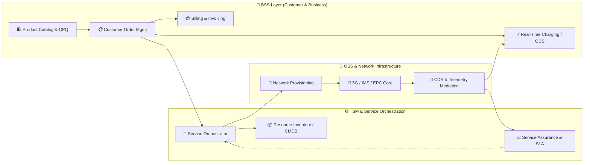
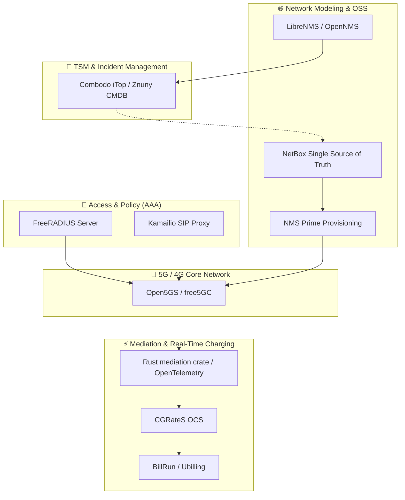

  

<h1 align="center">📡 Awesome Telecommunications Service Management (TSM) 🌐</h1>

  <strong>A curated ecosystem of enterprise SaaS platforms, open-source telecom BSS/OSS suites, real-time charging engines (OCS), and automated service orchestration frameworks for Communication Service Providers (CSPs), MVNOs, and regional ISPs.</strong>

  
  
  
  
  
  

---

## 📌 Overview &amp; Telecom Service Lifecycle

**Telecommunications Service Management (TSM)** forms the operational nervous system of modern telecommunications networks. It bridges customer-facing business systems (**BSS** — Business Support Systems) with technology-facing network operations (**OSS** — Operations Support Systems), orchestrating the complete lifecycle of connectivity services across 5G Standalone (SA), FTTH/broadband, mobile virtual network operations (MVNO), and edge computing.

Modern TSM unifies **service design, product catalog, customer ordering, automated provisioning, dynamic service assurance, revenue mediation, and real-time charging** under open API standards (such as **TM Forum Open Digital Architecture (ODA)** and **eTOM**).

---

## 📑 Table of Contents

- [📊 Sector Overview &amp; Market Dynamics](#-sector-overview--market-dynamics)
- [🏢 Enterprise SaaS &amp; Commercial Hosted Platforms](#-enterprise-saas--commercial-hosted-platforms)
- [💻 Open-Source GitHub Projects](#-open-source-github-projects)
  - [🌐 Network Resource Modeling &amp; IPAM](#-network-resource-modeling--ipam)
  - [📡 Core Cellular &amp; SIP Telephony Infrastructure](#-core-cellular--sip-telephony-infrastructure)
  - [⚡ Real-Time Charging &amp; Telecom Billing Engines](#-real-time-charging--telecom-billing-engines)
  - [🛠️ OSS Provisioning, NOC &amp; Network Surveillance](#️-oss-provisioning-noc--network-surveillance)
  - [🎫 Telecom IT Service Management &amp; Ticketing](#-telecom-it-service-management--ticketing)
  - [📊 Telemetry, Usage Mediation &amp; Observability](#-telemetry-usage-mediation--observability)
- [🏗️ Architectural Blueprint: Building a Sovereign Telecom Stack](#️-architectural-blueprint-building-a-sovereign-telecom-stack)
- [❓ Frequently Asked Questions (FAQ)](#-frequently-asked-questions-faq)
- [🤝 How to Contribute](#-how-to-contribute)
- [💖 Support &amp; Community](#-support--community)
- [📈 Star History](#-star-history)
- [📜 Disclaimer](#-disclaimer)

---

## 📊 Sector Overview &amp; Market Dynamics

- **Estimated Market Size**: The global **Telecommunications Service Management (TSM)** and **Telecom OSS/BSS** market is valued at approximately **$60.5 billion in 2024** and is projected to surpass **$112.8 billion by 2030**, advancing at a compound annual growth rate (CAGR) of **8.8% to 10.2%**. Expansion is propelled by worldwide 5G Standalone (5G SA) rollouts, dynamic network slicing monetization, enterprise private cellular networks, and GenAI-driven autonomous network operations (AIOps).
- **Market Fragmentation &amp; Competitive Concentration**: The sector exhibits **moderate-to-high concentration at the Tier-1 CSP level**, where legacy telecom operators rely on multi-year, hundred-million-dollar transformation contracts with dominant vendors (Amdocs, Netcracker, Ericsson, Oracle, and ServiceNow). Conversely, the market is **increasingly fragmented across Tier-2/3 operators, regional broadband ISPs, and MVNOs**, where microservices architectures, cloud-native deployments, TM Forum Open APIs, and open-source stacks are rapidly disrupting monolithic lock-in.

---

## 🏢 Enterprise SaaS &amp; Commercial Hosted Platforms

The following enterprise platforms provide managed, carrier-grade telecom service orchestration, customer care, convergent billing, and automated service assurance.

> *Sorted descending by company size (Valuation / Market Capitalization / Annual Revenue).*

| Product &amp; Platform | Company Size &amp; Valuation | Focus &amp; Core Capabilities | Starting Pricing | Free Tier / Trial Limits |
| :--- | :--- | :--- | :--- | :--- |
| **[Oracle Communications](https://www.oracle.com/communications/)** | **~$450B+** Market Cap *(NYSE: ORCL)* • **~$53B+** Annual Revenue | **Oracle Digital BSS Express (DBX)** &amp; OCI Communications Cloud covering subscriber catalog, order orchestration, convergent rating, and pre-built TM Forum eTOM workflows. | Starts from **~$1,500–$3,000/mo** (OCI communications baseline instances &amp; Autonomous DB) or **~$0.005–$0.015 per subscriber/mo** for managed BSS suites. | **Always Free Tier** (2 AMD Compute VMs, up to 4 Arm Ampere cores / 24GB RAM, 2 Autonomous DBs) + **30-day Free Trial with $300 cloud credits**. |
| **[ServiceNow TSM](https://www.servicenow.com/products/telecommunications-service-management.html)** | **~$185B+** Market Cap *(NYSE: NOW)* • **~$9.5B+** Annual Revenue | Telecom-specific orchestration layer on the Now Platform bridging customer service management (CSM) with Network Operations Centers (NOC); leverages telco AI agents for incident diagnosis. | Starts at **~$70–$100/agent/mo** (entry Fulfiller tier) or minimum annual enterprise contracts starting at **~$30,000–$40,000/yr** (~$2,500–$3,300/mo). | **Indefinite Free Developer Instance (PDI)** with full Now Platform &amp; TSM workflow builder access (valid if accessed every 10 days; automatically hibernates when idle). |
| **[Ericsson Digital BSS](https://www.ericsson.com/en/portfolio/digital-services/digital-bss)** | **~$22B+** Market Cap *(NASDAQ: ERIC)* • **~$25B+** Annual Revenue *(SEK 263B)* | Cloud-native **Digital Monetization Platform** covering real-time convergent charging, billing mediation, order care, and TM Forum Open API conformance for 5G network slicing. | Commercial deployments starting from **~$15,000–$25,000/mo** (~$180k–$300k/yr baseline) or **~$0.08–$0.15 per active subscriber/mo** for regional/MVNO deployments. | **No free forever plan**; **30-day guided Proof of Concept (PoC)** sandbox available for qualified CSPs upon partner evaluation request (pre-loaded with 5G call models). |
| **[Netcracker Technology](https://www.netcracker.com/)** | **~$16B+** Parent *(NEC Corp TYO: 6701)* • **~$1.2B+** Annual Revenue | End-to-end **Digital Platform** covering service fulfillment, zero-touch network orchestration, AI-driven digital commerce, and customer engagement across B2C, B2B, and wholesale. | Modular cloud instances starting at **~$10,000–$15,000/mo** (~$120k/yr baseline) or **~$0.10–$0.20 per active subscriber/mo** depending on enabled functional modules. | **No free forever plan**; **30-day guided enterprise testbed trial** sandbox with TM Forum Open API test harness and mock product catalog workflows. |
| **[Amdocs](https://www.amdocs.com/)** | **~$10.5B+** Market Cap *(NASDAQ: DOX)* • **~$5.0B+** Annual Revenue | Market-leading carrier BSS/OSS suite powered by the **aOS** telco operating system; features GenAI copilots, cognitive customer care, real-time charging, and global revenue mediation. | Cloud-hosted modular microservices starting at **~$12,000–$20,000/mo** (~$150k/yr baseline) or **~$0.05–$0.12 per subscriber/mo** for cloud transformations. | **No free forever plan**; **30-day Proof of Value (PoV) sandbox** for qualified CSP operators with simulated CDR rating scenarios and digital care journeys. |
| **[CSG Systems](https://www.csgi.com/)** | **~$1.6B+** Market Cap *(NASDAQ: CSGS)* • **~$1.1B+** Annual Revenue | **CSG Ascendon &amp; Forte** digital monetization suites powering subscriber billing, recurring payments, mediation, and customer communications for over 600M subscribers globally. | SaaS platform subscriptions starting at **~$5,000–$8,000/mo** (~$60k–$96k/yr baseline) plus **~$0.02–$0.05 per active billing subscriber/mo**. | **No free forever plan**; **14-day interactive test sandbox** and developer API portal with mock subscriber billing records and settlement models. |
| **[Hansen Technologies](https://www.hansencx.com/)** | **~$850M+** USD Market Cap *(ASX: HSN)* • **~$230M+** USD Annual Revenue | **Hansen CCB (Customer Care and Billing)** &amp; CPQ suite purpose-built for energy and telecommunications providers, managing multi-play broadband, pay-TV, and voice services. | Entry SaaS subscription starting at **~$4,000–$6,000/mo** (~$48k–$72k/yr) for regional service providers with tiered pricing scaling per active service instance. | **No free forever plan**; **30-day guided demo sandbox** with pre-configured telco product catalog, rate cards, and billing cycle simulations. |
| **[Comarch](https://www.comarch.com/telecommunications/)** | **~$650M+** Valuation • **~$480M+** Annual Revenue | Modular telecommunications BSS/OSS portfolio delivering real-time OSS, SDN/NFV service orchestration, zero-touch provisioning, field service management, and IoT monetization. | Modular entry deployments starting at **~$3,500–$5,500/mo** (~$42k–$66k/yr baseline) for regional CSPs and ISP operational deployments. | **30-day evaluation trial** with restricted API throughput (capped at 5,000 test transactions) and sandbox access to network inventory and service fulfillment modules. |
| **[Cerillion](https://www.cerillion.com/)** | **~$650M+** Market Cap *(LSE: CER)* • **~$55M+** Annual Revenue | Cloud-native modular BSS/OSS suite featuring convergent billing, charging, GenAI-assisted workflow configuration, CRM, and unified telecom service manager. | Entry cloud SaaS modules starting at **~$4,500–$7,500/mo** (~$54k–$90k/yr) or **~$0.15 per active subscriber/mo** for convergent multi-play billing. | **No free forever plan**; **30-day Proof of Concept (PoC) staging environment** with sample tariff plans, customer hierarchy models, and CDR rating engines. |
| **[Subex](https://www.subex.com/)** | **~$220M+** Market Cap *(NSE: SUBEXLTD)* • **~$45M+** Annual Revenue | **HyperSense Business Assurance** &amp; Fraud Management System (FMS); leverages AI to analyze 150B+ daily telecom transactions, preventing margin leakage and bypass fraud. | Platform modules starting at **~$2,500–$4,000/mo** (~$30k–$48k/yr) for revenue assurance or fraud monitoring inspection pipelines. | **14-day guided Proof of Value (PoV) trial** analyzing up to 100,000 simulated CDR / network records for fraud patterns and margin leakage detection. |

---

## 💻 Open-Source GitHub Projects

A comprehensive collection of production-grade open-source projects for self-hosted telecom infrastructure, cellular core, billing engines, and OSS provisioning.

> *Sorted descending by GitHub Stars_Count.*

### 🌐 Network Resource Modeling &amp; IPAM

- **[NetBox](https://github.com/netbox-community/netbox)**   
  The industry-standard source of truth for network automation, IP address management (IPAM), datacenter infrastructure management (DCIM), circuit tracking, and telecom equipment topology.

### 📊 Telemetry, Usage Mediation &amp; Observability

- **[OpenTelemetry Collector](https://github.com/open-telemetry/opentelemetry-collector)**   
  High-throughput, vendor-neutral proxy used across modern telecom environments to ingest, transform, and route network metrics, call trace events, and CDR mediation pipelines.

### 🛠️ OSS Provisioning, NOC &amp; Network Surveillance

- **[LibreNMS](https://github.com/librenms/librenms)**   
  Auto-discovering, GPL-licensed network monitoring system (OSS) supporting SNMP, syslog, BGP/OSPF telemetry, interface capacity planning, and carrier alerting workflows.

- **[OpenNMS](https://github.com/OpenNMS/opennms)**   
  Enterprise-grade, carrier-scale open-source network management platform engineered for telecom NOCs, delivering automated discovery, fault tracking, latency monitoring, and SLA verification.

- **[NOC Project](https://github.com/nocproject/noc)**   
  Carrier-grade OSS platform delivering multi-vendor device configuration management, automated service provisioning, IPAM, VLAN/VRF management, DNS control, and fault surveillance.

- **[CableLabs OS-Provisioning (NMS Prime)](https://github.com/cablelabs/os-provisioning)**   
  Modular open-source network provisioning and OSS platform developed under CableLabs; automates service activation across DOCSIS, FTTH, FTTx, DSL, and carrier WiFi networks.

### 📡 Core Cellular &amp; SIP Telephony Infrastructure

- **[Kamailio](https://github.com/kamailio/kamailio)**   
  High-performance open-source SIP server capable of handling thousands of call setups per second; powers large-scale VoIP, VoLTE, IMS core routing, and telecom SBC architectures.

- **[Open5GS](https://github.com/open5gs/open5gs)**   
  C-language open-source implementation of 5G Core (5GC) and 4G EPC (Evolved Packet Core), supporting 3GPP Release 16/17 standards for private cellular networks and service slice testing.

- **[FreeRADIUS Server](https://github.com/FreeRADIUS/freeradius-server)**   
  The world's most widely deployed open-source AAA (Authentication, Authorization, and Accounting) policy server, authenticating hundreds of millions of broadband and mobile subscribers.

- **[free5GC](https://github.com/free5gc/free5gc)**   
  Pure Go open-source 5G Core Network compliant with 3GPP Release 17; built for network function virtualization (NFV), private mobile networks, and academic/commercial telco testbeds.

### 🎫 Telecom IT Service Management &amp; Ticketing

- **[Combodo iTop](https://github.com/Combodo/iTop)**   
  Web-based CMDB and ITIL-aligned IT Service Management platform tailored for telecommunications service desks, handling customer impact analysis, incident routing, and SLA tracking.

- **[Znuny](https://github.com/znuny/Znuny)**   
  Hardened, enterprise-grade open-source service management and customer support ticketing platform (fork of OTRS) widely used by telecom operations centers and NOCs.

### ⚡ Real-Time Charging &amp; Telecom Billing Engines

- **[CGRateS](https://github.com/cgrates/cgrates)**   
  Carrier-grade, real-time Online/Offline Charging System (OCS) in Go; features multi-tenant rating, session reservation, balance management, CDR logging, and Least Cost Routing (LCR).

- **[Ubilling](https://github.com/nightflyza/Ubilling)**   
  Open-source billing and subscriber lifecycle management platform designed for regional Internet Service Providers (ISPs), featuring payment gateway integration and network polling.

- **[BillRun](https://github.com/BillRun/system)**   
  Open-source telecom billing, charging, and revenue assurance platform designed for telecom operators, DSPs, and IoT providers, handling high-volume CDR mediation and invoicing.

- **[mediation (Rust)](https://github.com/hupe1980/mediation)**   
  High-throughput telecom usage mediation domain library in Rust; provides CDR parsing, deduplication, ASN.1 decoding, sequence tracking, and 3GPP charging record validation.

---

## 🏗️ Architectural Blueprint: Building a Sovereign Telecom Stack

For regional ISPs, MVNO operators, and private 5G network architects looking to build an unconstrained, sovereign telecom service management stack without proprietary per-subscriber licensing lock-in:

1. **Modeling &amp; Provisioning**: Use **NetBox** as the single source of truth for all IPAM, rack layouts, and fiber circuit mappings. Pair with **CableLabs NMS Prime** for automated subscriber CPE provisioning across FTTH, DOCSIS, and fixed wireless.
2. **Cellular Connectivity &amp; Voice**: Deploy **Open5GS** or **free5GC** for 3GPP Release 16/17 private 5G Core services, fronted by **Kamailio** for SIP/IMS call routing and **FreeRADIUS** for subscriber AAA.
3. **Usage Mediation &amp; Real-Time Charging**: Stream data session records and voice CDRs into the **Rust mediation library** and **OpenTelemetry Collector** for normalization, then pipe directly into **CGRateS** for millisecond-latency balance reservation, rating, and fraud cutoff.
4. **Subscriber Care &amp; Invoicing**: Manage subscriber invoicing, recurring plans, and credit card / SEPA direct debits via **BillRun** or **Ubilling**.
5. **NOC Incident &amp; SLA Management**: Connect network traps and performance metrics from **LibreNMS** or **OpenNMS** into **Combodo iTop** or **Znuny** to deliver ITIL-compliant telecom service desk automation.

---

## ❓ Frequently Asked Questions (FAQ)

<strong>What is Telecommunications Service Management (TSM)?</strong>

Telecommunications Service Management (TSM) is the specialized framework and software ecosystem used by Communication Service Providers (CSPs), mobile network operators (MNOs), MVNOs, and broadband ISPs to manage the full lifecycle of connectivity and digital services. Unlike generic IT Service Management (ITSM), TSM natively handles telco-specific constructs including subscriber SIM management, CDR mediation, real-time rating and charging, network function virtualization (NFV), service catalog management (SID), and automated provisioning across multi-vendor transport and cellular cores.

<strong>What is the difference between Telecom BSS and OSS?</strong>

- **BSS (Business Support Systems)**: Customer-facing systems that manage business interactions—including CRM, product catalog, configure-price-quote (CPQ), order capture, subscription billing, and revenue management.
- **OSS (Operations Support Systems)**: Network-facing systems that manage underlying physical and virtual infrastructure—including network inventory, automated provisioning, fault management, performance telemetry, and service assurance.
- **TSM Orchestration**: Serves as the cognitive bridge that translates commercial BSS orders into actionable OSS network provisioning instructions and feeds real-time network telemetry back into customer service workflows.

<strong>What are TM Forum Open APIs and eTOM?</strong>

The **TM Forum** is the global industry association establishing standardized operational frameworks for telecommunications. **eTOM** (enhanced Telecom Operations Map) provides the blueprint for business processes across strategy, infrastructure, and operations. **TM Forum Open APIs** (such as TMF620 Product Catalog, TMF622 Product Ordering, TMF641 Service Ordering, and TMF645 Service Qualification) provide standard REST/JSON schemas enabling interoperability between disparate BSS, OSS, and cloud vendors.

<strong>Can open-source software realistically run a commercial MVNO or ISP?</strong>

Yes. Tier-2/3 operators, regional ISPs, and MVNOs frequently run mission-critical production services combining **FreeRADIUS** for subscriber AAA, **CGRateS** for real-time rating, **Open5GS** for private cellular slices, **NetBox** for IPAM, and **BillRun** or **Ubilling** for customer accounting. While Tier-1 CSPs (e.g., AT&amp;T, Vodafone) typically utilize commercial suites (Amdocs, Ericsson) due to multi-decade carrier SLAs and liability indemnification, open-source stacks offer immense cost savings and zero per-subscriber licensing fees for agile operators.

---

## 🤝 How to Contribute

Contributions are warmly welcomed! Help keep this curated ecosystem fresh and accurate:

1. 🍴 **Fork** this repository.
2. 🌿 Create a descriptive branch (`git checkout -b feature/add-telecom-tool`).
3. 📝 Update `README.md` following the established table / format.
4. 💡 Ensure vendor pricing, free trial specifications, and repository star links are verifiable.
5. 🚀 Submit a **Pull Request** detailing your additions.

Explore more curated developer lists across modern tech stacks at [Awesome Awesome Awesome](https://github.com/ishandutta2007/Awesome-Awesome-Awesome)!

---

## 💖 Support &amp; Community

Thank you for exploring and contributing to the **Awesome Telecommunications Service Management (TSM)** ecosystem! Open and programmable telecom infrastructure thrives through community collaboration.

If this curated guide helps your engineering evaluations or network deployments, please consider:
- ⭐ **Starring** this repository to help telecom architects and DevOps engineers discover it.
- 🔀 **Forking** and contributing updates, open-source tools, or architectural benchmarks.
- 📢 **Sharing** with your network, telecom engineering forums, and LinkedIn groups.
- ☕ **Sponsoring** ongoing maintenance and research:

  

Your support fuels ongoing updates and high-quality open-source curation!

---

##  Star History

---

## 📜 Disclaimer

- This repository is a **community-curated collection** created for technical evaluation, educational, and architectural reference purposes only.
- Telecom service management platforms handling subscriber records (PII), call detail records (CDRs), and lawful interception are subject to stringent jurisdictional compliance mandates (including GDPR, HIPAA, ePrivacy, FCC CALEA, and local telecom regulatory licensing).
- Always verify licensing terms, vendor security bulletins, and carrier-grade high-availability (99.999% "five nines") requirements prior to deploying solutions into production cellular or ISP network environments.

---

  <i>Maintained with 📡 for telecommunication engineers, CSP operations teams, and network automation developers worldwide.</i>

